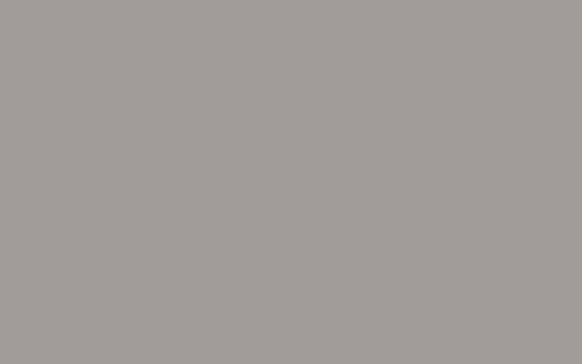

# SLINGSHOT

SLINGSHOT adalah situs agensi brand independen (fiktif) untuk merek **sport, outdoor & performance**: sepatu lari, ski, surf, padel, sepeda, minuman olahraga, wearable. Situs ini untuk calon klien (brand manager, marketing lead) yang ingin melihat portofolio, cara kerja, dan berita agensi. Ini adalah rebuild orisinal yang meniru tata letak dan perilaku sebuah situs agensi referensi, dengan konsep produk, palet warna, copy, nama klien, logo, dan seluruh gambar yang baru.

## Halaman

| File | Isi |
|---|---|
| `index.html` | Home: preloader SLING/SHOT, hero berganti foto, intro, huruf "S" yang digambar lalu diisi foto dan membesar, featured project slider, daftar proyek (list/grid), headlines slider, kota studio, footer |
| `work.html` | "The proof" (judul vertikal pinned + 2 kolom poster dengan parallax) dan "All projects" dengan filter Services/Industry |
| `about.html` | Manifesto, film (modal video), "We build momentum through defiance", accordion "What we deliver", slider "Grit & heart" |
| `news.html` | Judul berjalan, filter All/Thinking/Press, grid artikel |
| `contact.html` | Form kontak (demo, tidak mengirim apa pun) |
| `newsletter.html` | Form newsletter (demo) |
| `privacy.html`, `terms.html`, `cookies.html` | Halaman legal |
| `work-<slug>.html` (12) | Studi kasus: Kestrel Run, Nordvik Ski, Tideform, Orbit Padel, Halden Cycles, Fernway Trail, Volta Water, Gritstone, Aurora Swim, Blockparty, Summit & Sons, Pacemaker. Tiap halaman: hero, intro + meta, galeri, kutipan, slider touchpoints, "Next up" ke proyek berikutnya |
| `news-<slug>.html` (12) | Artikel: judul besar, foto, lead, isi, kutipan, 3 artikel terkait |

## Fitur & interaksi

- **Preloader** (sekali per sesi, `sessionStorage`): wordmark terbelah, kotak foto membesar sambil berganti gambar, lalu meluas ke hero.
- **Smooth scroll** khusus wheel mouse; sentuh, keyboard, scrollbar, anchor, dan `scrollTo` tetap native.
- **Header** sembunyi saat scroll turun, muncul saat naik; logo berganti warna di atas section gelap. Nav pill aktif per halaman.
- **Transisi halaman**: fade warna latar saat pindah halaman.
- **Home**: glyph "S" (SVG stroke → clip foto → zoom), featured slider auto 5 dtk yang menempel jadi strip 90 px, daftar proyek dengan gambar sticky di tengah dan teks `mix-blend-mode: difference`, toggle LIST/GRID, slider berita drag dengan inersia, marquee kota (hover kota = sorot + kartu alamat).
- **Footer reveal** (sticky di bawah konten) dengan wordmark raksasa; versi mobile ditumpuk.
- **State**: dropdown filter, filter berita, accordion layanan, modal film (Esc/klik luar untuk tutup), pager slider, validasi form, hover poster (huruf bergeser + tombol panah).
- **Responsif** 1440 px dan 390 px (ukuran berbasis `vw`), menghormati `prefers-reduced-motion`.
- Tanpa sound (situs referensi juga tidak memakai sound).

## Teknologi

HTML, CSS, dan JavaScript native, tanpa framework dan tanpa langkah build. Satu loop `requestAnimationFrame` menggerakkan semua efek scroll (hanya `transform`/`opacity`).

Font (Google Fonts): **Inter Tight** 400/500 (pengganti Sequel Sans yang berlisensi), **Newsreader** 300 regular/italic (pengganti Mixta Pro), **Jost** 600 untuk wordmark. Font dimuat online; tanpa internet browser memakai fallback Arial/Georgia.

## Cara menjalankan

Buka `index.html` langsung di browser (klik dua kali). Tidak perlu server. Video di halaman About diputar setelah tombol "Watch film" diklik.

## Struktur folder

```
.
├── index.html, work.html, about.html, news.html
├── contact.html, newsletter.html, privacy.html, terms.html, cookies.html
├── work-*.html (12 studi kasus)
├── news-*.html (12 artikel)
├── css/style.css
├── js/main.js
├── assets/
│   ├── img/   (77 gambar .jpg)
│   └── video/film.mp4
├── docs/preview/homepage.gif, hero.png
└── README.md
```

## Mengedit konten & aset

Semua halaman adalah HTML final, jadi edit langsung di file:

- **Teks**: buka file `.html` yang sesuai. Header dan footer ada di setiap halaman; bila mengubah menu atau footer, ubah di semua file (cari-ganti di editor).
- **Warna & font**: variabel di `:root` paling atas `css/style.css` (`--chalk` latar, `--ink` teks/section gelap, `--ink-deep` footer, `--accent` oranye, `--grey`, `--mute`, `--sans`, `--serif`, `--mark`).
- **Ukuran**: dalam `vw`; blok `@media (max-width: 767px)` di akhir CSS untuk mobile.
- **Gambar**: ganti file di `assets/img/` dengan nama yang sama, atau ubah `src` di HTML. Poster proyek `poster-N.jpg`, hero studi kasus `caseb-N.jpg`.
- **Data kota pada kartu hover**: objek `cityData` di `js/main.js`.
- **Form**: `contact.html` dan `newsletter.html` hanya memvalidasi dan menampilkan pesan demo; sambungkan `<form>` ke endpoint Anda sendiri.

## Placeholder yang perlu diganti

Nama brand SLINGSHOT dan wordmark, tagline "Build momentum through defiance", 12 nama klien dan studi kasus (semuanya fiktif), nama dan kutipan testimoni ("Alex Morgan (fictional)"), alamat dan telepon 8 studio (Lisbon, Berlin, Tokyo, Oslo, Seoul, Denver, Cape Town, Jakarta), email `hello@slingshot.example`, tautan Instagram/LinkedIn/Careers (masih `#`), dan isi halaman legal.

## Kredit & lisensi aset

- **Gambar**: semua dihasilkan AI (Nano Banana via Google Flow), kecuali `film-1.jpg` yang diambil dari frame video di bawah.
- **Video**: "Man runs past, ground level shot" dari [Mixkit](https://mixkit.co/free-stock-video/man-runs-past-ground-level-shot-32809/), Mixkit Stock Video Free License.
- **Font**: Inter Tight, Newsreader, Jost dari Google Fonts (SIL Open Font License).

## Keterbatasan

- Font referensi (Sequel Sans, Mixta Pro) berlisensi, jadi diganti alternatif gratis; lebar huruf sedikit berbeda.
- Hero referensi berupa video showreel; di sini diganti potongan foto yang berganti cepat.
- Kuota harian Google Flow habis sebelum gambar 16:9 dibuat, sehingga slot lebar (hero home, hero studi kasus, latar kota) memakai foto 4:3 hasil Flow yang di-crop `object-fit: cover`. Untuk ketajaman maksimal di layar besar, ganti dengan versi 16:9 2K.
- Bentuk "S" dan efek zoom ditulis sendiri (SVG + CSS), mendekati efek glyph 3D pada referensi, tidak identik.
- Halaman detail tidak memakai transisi Flip antarhalaman seperti referensi (SPA); diganti fade antarhalaman.
